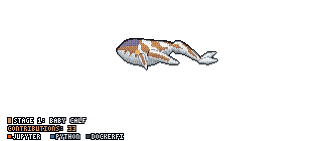

Hi, My name is Sina Rahimian   
======================================================================================================================================

Ai in healthcare reseacher,Cs graduate 
---------------------------

* 🖥️  See my portfolio at [sinarahimian.xyz](http://sinarahimian.xyz)
* 🧠  I'm currently learning Ai agents,Deeplearning
* 👥  I'm looking for ms ai opportunities and ai in healthcrae projects
* 💬  Ask me about classical ml,ai in healthcare problems
* 🔗  contact me on <a href=https://www.linkedin.com/in/sinarahimian/> linkedin </a> for furture collabration!

   

  

